<div align="center">

# 정형 데이터 분석 · 머신러닝 프로젝트

HYROX 대회 구간 기록 6만 건을 활용한 **탐색적 데이터 분석(EDA), 전처리, 군집, 회귀, 분류** 프로젝트

`Python` · `pandas` · `scikit-learn` · `matplotlib` · `Jupyter Notebook`

<br />

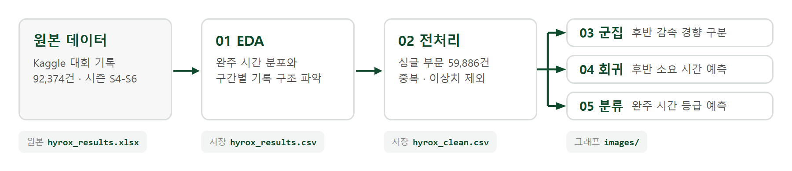

</div>

---

## 1. 프로젝트 개요

- **배경:** HYROX 대회 참가 과정에서 후반 체력 배분의 중요성에 대한 조언을 자주 접함
- **문제 정의:** 후반 속도 저하가 나타나는 선수의 비율과 그 정도를 데이터로 확인
- **목표:** 공개 대회 기록 기반 후반 감속 정량화, 전반 기록을 활용한 후반 기록 예측
- **기간:** 2026.10 – 2026.11 (3주)
- **역할:** 개인 프로젝트 (문제 정의, EDA, 전처리, 모델링, 평가 설계)
- **데이터:** Kaggle [Hyrox Race Results](https://www.kaggle.com/datasets/jgug05/hyrox-results) (CC BY 4.0), 시즌 S4-S6 완주 기록 중 개인 부문 59,886건

| 영역 | 기술 | 활용 |
| --- | --- | --- |
| 데이터 처리 | pandas, openpyxl | 시간 문자열 변환, 집계, 전처리 기준 적용 |
| 모델링 | scikit-learn | K-Means(군집), 선형 회귀, 릿지 회귀, 랜덤 포레스트(회귀), 로지스틱 회귀, 랜덤 포레스트(분류) |
| 시각화 | matplotlib | 분포, 구간별 비교, 군집, 오차, 혼동 행렬 |
| 개발 도구 | Jupyter Notebook, Anaconda, Git | 단계별 분석 노트북, 가상 환경, 버전 관리 |

---

## 2. 핵심 역량

| 역량 | 수행 내용 | 근거 |
| --- | --- | --- |
| **문제 정의** | 대회 참가 경험에서 도출한 질문을 "후반 감속 비율" 지표로 정량화하고 6만 건 기록으로 검증 | [4-2](#4-2-후반-감속-분석-군집) |
| **평가 설계** | 시즌 단위 학습·테스트 분할, 시즌 교차 검증 기반 모델 선택, 테스트 데이터 1회 사용 | [5-1](#5-1-평가-설계) |
| **데이터 누수 방지** | 입력 변수(1-4구간)와 타깃(5-8구간) 분리, 구간 합계 정합성 확인 | [5-2](#5-2-데이터-누수-방지) |
| **베이스라인 비교** | 모든 모델을 규칙 기반 베이스라인과 비교, 개선 폭이 작은 결과도 그대로 기록 | [5-3](#5-3-베이스라인-비교) |
| **결과 안정성 검증** | 표본 크기, 초기화 횟수 변경에 따른 군집 결과 재현성 확인 | [5-4](#5-4-결과-안정성-검증) |
| **분석 과정 문서화** | 제외 기준별 영향 건수, 분석자 판단 설정값, 단계별 한계를 노트북에 명시 | [5-5](#5-5-분석-과정-문서화) |

---

## 3. 분석 파이프라인

- 각 노트북이 이전 단계의 저장 파일을 읽는 구조로, 단계별 재실행과 검증 가능

| 단계 | 내용 |
| --- | --- |
| [01 EDA](notebooks/01_eda.ipynb) | 완주 시간 분포와 구간별 기록을 통한 데이터 구조 파악 |
| [02 전처리](notebooks/02_preprocessing.ipynb) | 중복, 0초 구간, 이상치 제외 기준 수립 |
| [03 군집](notebooks/03_clustering.ipynb) | 후반 감속 정도와 시간 배분 기준 선수 경향 분류 |
| [04 회귀](notebooks/04_regression.ipynb) | 전반 기록 기반 후반 소요 시간 예측 |
| [05 분류](notebooks/05_classification.ipynb) | 전반 기록 기반 완주 시간 등급 예측 |

**HYROX 경기 구성과 구간 정의**

- HYROX: 1km 러닝과 운동 스테이션 1개를 8회 반복하여 완주 시간을 겨루는 피트니스 대회

<p align="center">
  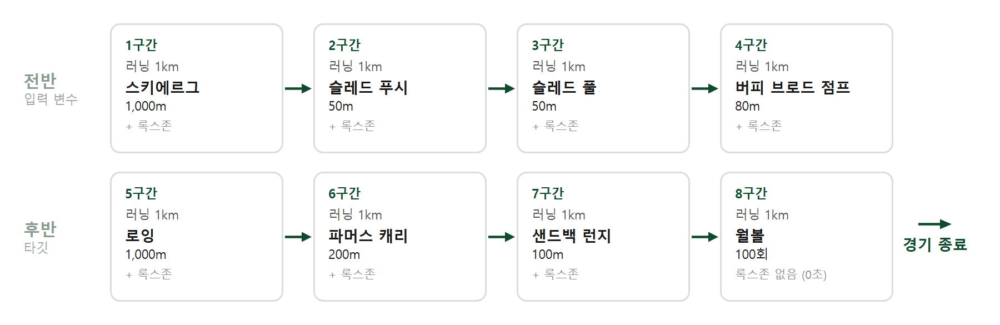
</p>

- **1구간** = 러닝 + 운동 스테이션 + 록스존(이동 구간), 분석 대상 구간 기록 23개 (8구간 록스존은 전 기록 0초로 제외)
- **전반(1-4구간) 기록을 입력 변수로, 후반(5-8구간)을 타깃으로** 하는 것이 회귀, 분류 모델의 기본 구조

<details>
<summary>부문, 데이터 범위</summary>

<br />

- 운동 스테이션 기록은 데이터상 `work_1`-`work_8` 번호로만 구분되어 종목명, 거리, 횟수는 HYROX 공개 규격 적용
- 부문: 오픈 싱글(일반 개인), 프로 싱글(운동 스테이션 중량이 더 높은 개인)
  - 2인 더블, 4인 릴레이 등 경기 형식이 다른 부문 제외
- 행 단위: 1회 완주 기록 (선수 식별 변수가 없어 동일 선수 여부 구분 불가)
- 용어 정리: [docs/glossary.md](docs/glossary.md)

</details>

---

## 4. 주요 분석

### 4-1. 탐색적 데이터 분석(EDA)과 전처리

- **이유:** 원본에 중복 기록, 0초 구간, 비정상적으로 긴 구간이 존재하여 분석 전 제외 기준 수립 필요
- **과정:** 부문 선택 → 중복 제외 → 0초 구간 제외 → 이상치 제외 순으로 단계별 제외 건수 기록

<p align="center">
  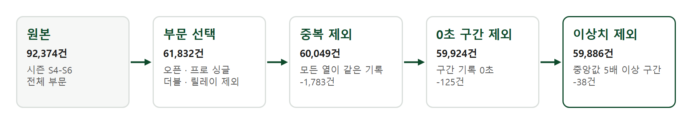
</p>

- **결과:**
  - 61,832 → 59,886건 (-1,946건, 3.1%)
  - 구간 중앙값 합계 러닝 43.5분 > 운동 스테이션 36.2분 > 록스존 6.4분, 8개 구간 중 7개에서 러닝 소요 시간이 더 김
  - 이상치 기준(기록 내 러닝 구간 중앙값의 5배)은 분포상 명확한 경계가 없어 분석자 판단으로 설정

<details>
<summary>EDA와 전처리 그래프</summary>

<br />

| 부문별 완주 시간 분포 | 구간별 중앙값 (러닝, 운동 스테이션) |
| --- | --- |
| 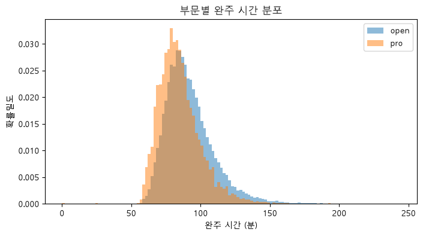 | 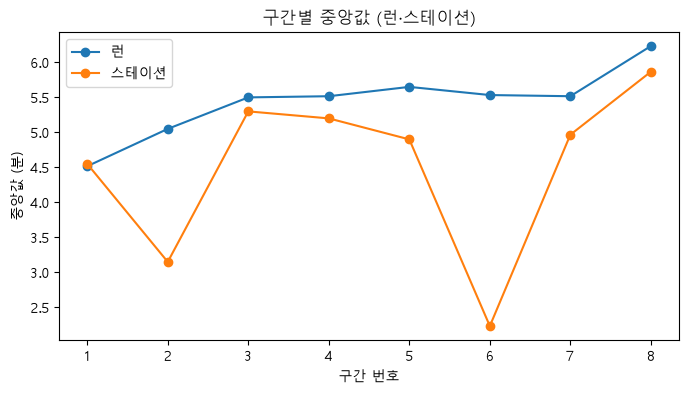 |

- 완주 시간 중앙값 87.7분 (오픈 싱글 89.0분, 프로 싱글 82.7분), 두 부문 분포가 넓게 겹침
- 러닝 중앙값: 1구간 4:31로 최단, 8구간 6:14로 최장

| 러닝 구간 최댓값 ÷ 중앙값 분포 | 전처리 전후 완주 시간 분포 |
| --- | --- |
| 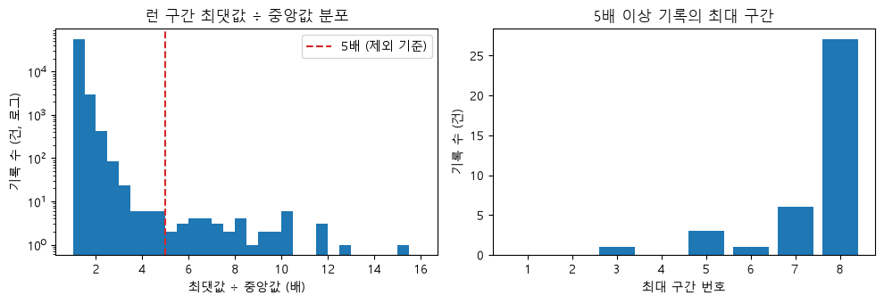 | 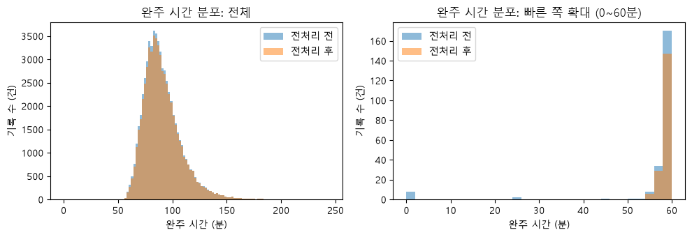 |

- 이상치 38건 중 최장 구간이 8구간인 경우 27건
- 완주 시간 중앙값 87.7 → 87.9분, 최솟값 0.0 → 54.1분

</details>

<details>
<summary>코드: 단계별 제외 기준 적용</summary>

<br />

[02_preprocessing.ipynb](notebooks/02_preprocessing.ipynb)

```python
step1 = sub.drop_duplicates().copy()                   # 모든 열이 같은 중복 기록 제외 (첫 기록 유지)

zero_flag = zero_by_type.any(axis=1)                   # 러닝, 스테이션, 록스존(1~7) 중 0초 구간 포함 여부
step2 = step1[~zero_flag].copy()

step2["런_중앙값(초)"] = step2[run_cols].median(axis=1)  # 기록 내 러닝 구간 중앙값
max_ratio = step2[run_cols].max(axis=1) / step2["런_중앙값(초)"]
big_flag = max_ratio >= 5                              # 이상치 기준: 최장 구간이 중앙값의 5배 이상
clean = step2[~big_flag].copy()
print(f"구간 이상 제외: {len(step2)} → {len(clean)} (-{big_flag.sum()}건)")
# (단계별 건수 집계, 그래프 생략)
```

</details>

### 4-2. 후반 감속 분석 (군집)

- **이유:** 후반 속도 저하가 얼마나 흔한지, 감속 정도에 따라 선수 경향이 나뉘는지 확인
- **과정:**
  - 후반 감속 비율(5-8구간 러닝 평균 ÷ 1-4구간 러닝 평균) 분포 확인
  - 특징 후보 4개의 분포와 상관 확인 (러닝, 스테이션, 록스존 비중 합 1.0, 러닝과 스테이션 비중 상관 -0.86) 후 러닝 비중과 후반 감속 비율을 군집 입력으로 선택
  - 표준화 후 K-Means 적용, k=2-5 중 실루엣 계수와 관성 기준으로 k=3 선택

| 후반 감속 비율 | 하위 5% | 하위 25% | 중앙값 | 상위 5% |
| --- | --- | --- | --- | --- |
| 값 | 0.995 | 1.070 | 1.114 | 1.291 |
| 의미 | 약 95%가 같거나 느림 | 75%가 7% 이상 느림 | 50%가 11% 이상 느림 | 5%가 29% 이상 느림 |

<p align="center">
  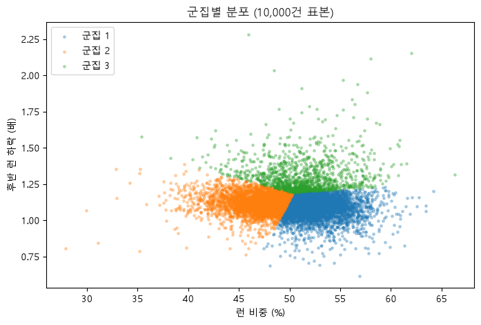
</p>

- **결과:**
  - 참가자 약 95%가 후반 러닝에서 속도가 같거나 저하, 50%는 11% 이상 감속
  - 감속이 가장 큰 군집 3(7,069건)의 완주 시간 중앙값 103.2분, 감속이 가장 작은 군집 1은 84.0분
  - 실루엣 계수 0.353으로 군집 경계가 뚜렷하지 않아, 유형이 아닌 경향 수준의 구분으로 해석
  - 그래프의 "후반 런 하락"은 후반 감속 비율과 같은 값

<details>
<summary>군집 프로파일과 군집 수 선택</summary>

<br />

| 군집 | 기록 수 (건) | 러닝 시간 비중 | 후반 감속 비율 (중앙값) | 완주 시간 중앙값 (분) |
| --- | --- | --- | --- | --- |
| 1 | 29,369 | 0.521 | 1.092 | 84.0 |
| 2 | 23,448 | 0.474 | 1.120 | 90.0 |
| 3 | 7,069 | 0.511 | 1.271 | 103.2 |

- 러닝 시간 비중 = 러닝 시간 합 ÷ 완주 시간
- 완주 시간은 군집 입력 변수에서 제외하고, 군집 정렬과 비교에만 사용

<p align="center">
  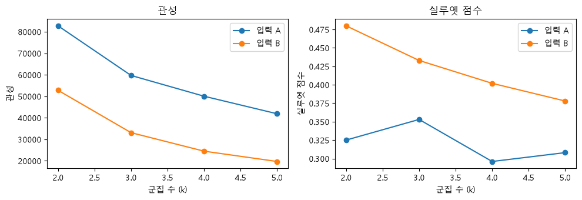
</p>

- k=2-5 중 실루엣 계수 최대 k=3 (0.353), 관성(Inertia) 감소 폭도 k=2→3에서 최대

</details>

<details>
<summary>코드: 특징 생성과 군집 수 비교</summary>

<br />

[03_clustering.ipynb](notebooks/03_clustering.ipynb)

```python
run_early = clean[[f"run_{i}_sec" for i in range(1, 5)]].mean(axis=1)  # 러닝 1~4구간 평균
run_late = clean[[f"run_{i}_sec" for i in range(5, 9)]].mean(axis=1)   # 러닝 5~8구간 평균

features = pd.DataFrame({
    "런 비중": clean["run_time_sec"] / clean["total_sec"],
    "후반 런 하락": run_late / run_early,                  # 1보다 클수록 후반 러닝이 느림
})
X = StandardScaler().fit_transform(features[["런 비중", "후반 런 하락"]])

for k in range(2, 6):                                      # 군집 수 후보별 관성, 실루엣 계수 비교
    km = KMeans(n_clusters=k, n_init=10, random_state=42).fit(X)
    sil = silhouette_score(X[sample], km.labels_[sample])  # 실루엣 계수는 10,000건 표본으로 계산
# (스테이션, 록스존 비중 후보와 결과 출력 생략)
```

</details>

### 4-3. 후반 소요 시간 예측 (회귀)

- **이유:** 전반 기록만으로 후반 소요 시간을 어느 정도 정확하게 예측할 수 있는지 확인
- **과정:**
  - 입력 변수: 1-4구간 기록 12개 → 타깃: 5-8구간 소요 시간 합
  - 모델 후보: 선형 회귀(비교 기준이 되는 단순 모델), 릿지 회귀(러닝 2-4구간 간 상관 0.77-0.83), 랜덤 포레스트(앙상블 계열)
  - 시즌 교차 검증(S4→S5, S5→S4) MAE 기준으로 모델 선택 후 테스트 데이터(S6)로 1회 평가

| 테스트 데이터(S6) | MAE (분) | R² |
| --- | --- | --- |
| 베이스라인: 학습 데이터 평균 | 7.16 | -0.01 |
| 베이스라인: 1-4구간 합 × 비율 | 3.36 | 0.77 |
| **랜덤 포레스트 (선택)** | **2.99** | **0.80** |

- **결과:**
  - MAE 2.99분으로 베이스라인 대비 0.37분 개선
  - 후반 소요 시간 상위 25% 구간에서 오차 최대 (MAE 5.01분, 하위 25%는 1.94분)

<details>
<summary>검증 점수와 오차 분석</summary>

<br />

| 회귀 검증 점수 (시즌 2분할) | 5-8구간 소요 시간별 MAE |
| --- | --- |
| 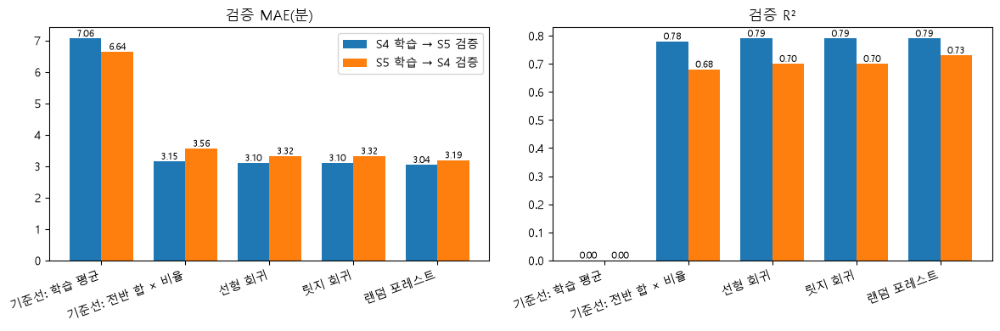 | 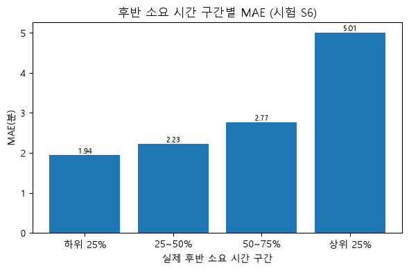 |

- 랜덤 포레스트가 양방향 검증 모두에서 MAE 최소, 단 선형 모델과의 차이는 0.06-0.13분
- 오차(예측 − 실제) 평균 -0.13분, 절대 오차 중앙값 2.14분

</details>

<details>
<summary>코드: 시즌 교차 검증과 베이스라인 비교</summary>

<br />

[04_regression.ipynb](notebooks/04_regression.ipynb)

```python
folds = [("S4", "S5"), ("S5", "S4")]                    # (학습 시즌, 검증 시즌)

for tr, va in folds:
    X_tr, y_tr = X_all[season == tr], y_all[season == tr]
    X_va, y_va = X_all[season == va], y_all[season == va]
    ratio = (y_tr * 60 / X_tr.sum(axis=1)).median()   # 후반 ÷ 전반 중앙값, 학습 시즌만 사용
    preds = {
        "기준선: 학습 평균": np.full(len(y_va), y_tr.mean()),
        "기준선: 전반 합 × 비율": X_va.sum(axis=1) * ratio / 60,
    }
    for name, model in make_models().items():        # 선형 회귀, 릿지 회귀, 랜덤 포레스트
        preds[name] = model.fit(X_tr, y_tr).predict(X_va)
    for name, p in preds.items():
        rows.setdefault(name, {})[f"{tr}→{va} MAE(분)"] = mean_absolute_error(y_va, p)
# (R² 계산, 결과 출력 생략)
```

</details>

### 4-4. 완주 시간 등급 예측 (분류)

- **이유:** 전반 기록으로 완주 시간대를 등급 단위로 구분할 수 있는지 확인
- **과정:**
  - 대상: 완주 시간 70-100분 기록 (학습 25,212건, 테스트 15,967건), 10분 간격 3등급
  - 등급 경계는 공식 기준이 없어 참가 경험 기반으로 설정
  - 모델 후보: 로지스틱 회귀(단순 선형 모델, 표준화 적용), 랜덤 포레스트
  - 등급별 비율 차이를 고려하여 정확도와 Macro F1을 함께 사용

| 테스트 데이터(S6) | 정확도 | Macro F1 |
| --- | --- | --- |
| 베이스라인: 최빈 등급 일괄 예측 | 0.402 | 0.191 |
| 베이스라인: 1-4구간 합 기반 완주 시간 환산 | 0.732 | 0.759 |
| **로지스틱 회귀 (선택)** | **0.822** | **0.827** |

<p align="center">
  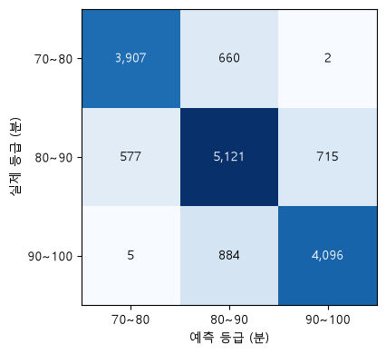
</p>

- **결과:**
  - 정확도 0.822로 베이스라인 대비 0.090 개선
  - 오분류 2,843건 중 2,836건이 인접 등급

---

## 5. 분석 설계와 검증

### 5-1. 평가 설계

- **문제:** 원본이 대회 단위로 정렬되어 있어 행 순서 기준 분할 부적합
- **해결:** 시즌 단위 분할(학습 S4, S5 / 테스트 S6), 학습 데이터 내 시즌 교차 검증으로 모델 선택
- **결과:** 테스트 데이터는 선택 모델과 베이스라인 평가에 1회만 사용

<p align="center">
  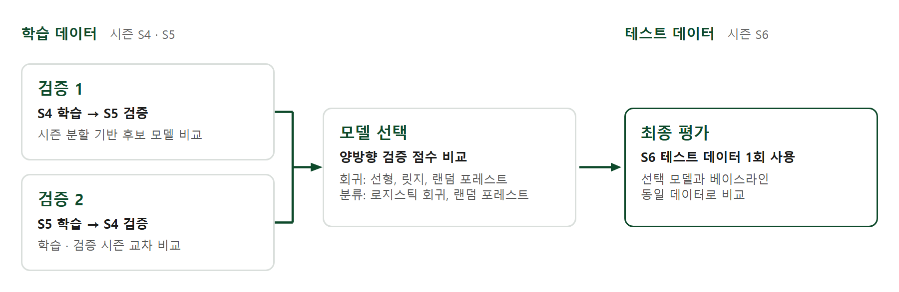
</p>

### 5-2. 데이터 누수 방지

- **문제:** 동일 완주 기록에서 입력 변수와 타깃을 생성하므로, 구간이 겹치면 타깃 정보가 입력에 포함됨
- **해결:** 입력 변수는 1-4구간, 타깃은 5-8구간으로 분리
- **결과:** 구간 중복 없음, 완주 시간 = 러닝 + 운동 스테이션 + 록스존 합 불일치 0건

<details>
<summary>코드: 입력 변수와 타깃 분리, 시즌 단위 분할</summary>

<br />

[04_regression.ipynb](notebooks/04_regression.ipynb)

```python
early_cols = [f"{k}_{i}_sec" for i in range(1, 5) for k in ["run", "work", "roxzone"]]  # 입력: 1~4구간 12열
late_cols = (
    [f"run_{i}_sec" for i in range(5, 9)]
    + [f"work_{i}_sec" for i in range(5, 9)]
    + [f"roxzone_{i}_sec" for i in range(5, 8)]        # roxzone_8은 전 기록이 0초라 제외
)

total_diff = clean["run_time_sec"] + clean["work_time_sec"] + clean["roxzone_time_sec"] - clean["total_sec"]
print("총 기록과 세 유형 합의 불일치(건):", (total_diff != 0).sum())   # 0건
print("입력·예측 대상에 겹치는 열:", set(early_cols) & set(late_cols))  # 없음

X_all = clean[early_cols]
y_all = clean[late_cols].sum(axis=1) / 60              # 타깃: 후반 소요 시간(분)
is_train = clean["season"].isin(["S4", "S5"])          # 학습: S4, S5 / 테스트: S6
X_train, X_test = X_all[is_train], X_all[~is_train]
y_train, y_test = y_all[is_train], y_all[~is_train]
```

</details>

### 5-3. 베이스라인 비교

- **문제:** 모델 점수만으로는 단순 규칙 대비 개선 정도 판단 불가
- **해결:** 모든 모델을 규칙 기반 베이스라인과 함께 제시
- **결과:** 회귀 MAE 3.36 → 2.99분, 분류 정확도 0.732 → 0.822, 개선 폭이 작은 결과도 그대로 기록

### 5-4. 결과 안정성 검증

- **문제:** 실루엣 계수는 표본 기반으로 계산되고, K-Means 결과는 초기화 횟수에 따라 달라질 수 있음
- **해결:** 표본 크기(5천, 1만, 2만 건)와 초기화 횟수(`n_init` 1, 10, 30) 변경 후 재확인
- **결과:** 표본 크기별 실루엣 계수 0.351-0.357, `n_init` 10과 30의 결과가 동일하여 `n_init=10` 적용

### 5-5. 분석 과정 문서화

- **문제:** 이상치 5배 기준, 등급 경계 등 분포상 명확한 근거가 없는 값 설정 필요
- **해결:** 제외 기준별 영향 건수 기록, 분석자 판단 설정값(`random_state=42`, 등급 경계, 5배 기준 등)을 노트북에 명시
- **결과:** 결과에는 확인된 수치만 기재하고, 해석과 한계는 별도 정리

---

## 6. 한계와 개선 방향

- **감속 원인:** 피로, 페이스 배분, 직전 운동 스테이션 영향 등은 본 데이터로 확인 불가
- **회귀 모델 간 차이:** 선형 모델과의 차이(0.06-0.13분)가 작고 검증이 2회에 그쳐 유의미한 차이인지 판단 불가
- **분류 점수:** 타깃(완주 시간)에 입력 변수(1-4구간 기록)가 포함되어 점수가 높게 산출될 가능성
- **부문 차이:** 오픈, 프로 싱글의 운동 스테이션 중량 차이가 데이터에 없어 동일 시간이라도 의미가 다를 수 있음
- **모델 설정:** scikit-learn 기본값만 사용, 하이퍼파라미터 탐색 필요
- **선수 식별:** 선수 식별 변수가 없어 학습, 테스트 데이터 간 동일 선수 포함 여부 확인 불가

---

<details>
<summary><b>실행 방법과 폴더 구조</b></summary>

<br />

**환경**

```bash
conda create -n hyrox-analysis python=3.12
conda activate hyrox-analysis
pip install pandas==3.0.6 scikit-learn==1.9.1 matplotlib==3.11.2 openpyxl==3.1.5 jupyter ipykernel
```

**데이터 준비** (`data/` 폴더는 Git 관리 대상에서 제외, 직접 생성)

- [Kaggle Hyrox Race Results](https://www.kaggle.com/datasets/jgug05/hyrox-results)에서 내려받아 `data/hyrox_results.xlsx`로 저장

**실행 순서** (각 노트북이 이전 단계의 저장 파일을 읽으므로 01부터 순서대로 실행)

| 순서 | 노트북 | 읽는 파일 | 저장하는 파일 |
| --- | --- | --- | --- |
| 1 | 01 | `data/hyrox_results.xlsx` | `data/hyrox_results.csv` |
| 2 | 02 | `data/hyrox_results.csv` | `data/hyrox_clean.csv` |
| 3-5 | 03, 04, 05 | `data/hyrox_clean.csv` | 없음 |

- 경로는 `notebooks/` 폴더 기준 상대 경로(`../data/`)
- 그래프 한글 폰트는 `Malgun Gothic`(Windows 기준), macOS, Linux에서는 각 노트북 첫 코드 셀의 `plt.rc("font", family=...)`를 설치된 한글 폰트로 변경

```text
hyrox-analysis/
├── notebooks/          # 01-05 분석 노트북
├── docs/
│   ├── glossary.md     # 용어 정리
│   └── diagrams/       # README 도식 원본(diagrams.html), 렌더 스크립트(render.ps1)
├── images/             # README용 그래프, 도식
├── data/               # Git 제외, 직접 준비
└── README.md
```

</details>

---

## 7. 회고

- **정형 데이터 분석 전 과정 직접 수행:** EDA → 전처리 → 군집 → 회귀 → 분류를 하나의 데이터셋으로 진행
- **데이터 분할 방식이 평가 결과에 미치는 영향 확인:** 행 순서가 아닌 시즌 단위 분할이 실제 상황(신규 시즌 예측)에 가까운 평가 방식
- **베이스라인 비교의 중요성:** 모델 점수는 베이스라인과 비교할 때 의미를 가지며, 개선 폭이 작은 결과도 그대로 기록

---

<div align="center">

### 정형 데이터 분석 · 머신러닝 프로젝트

**HYROX 대회 기록 분석**

</div>
