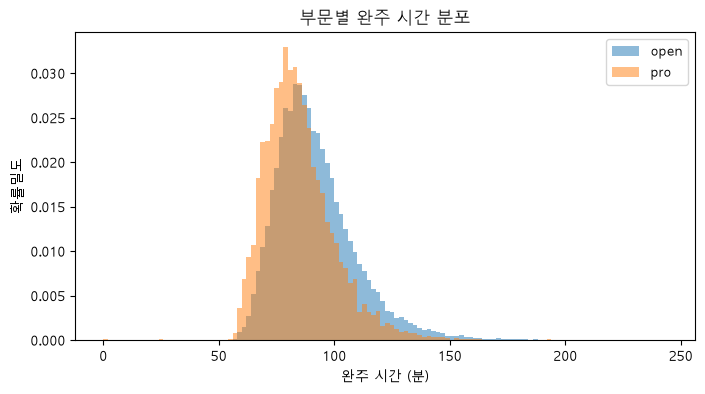
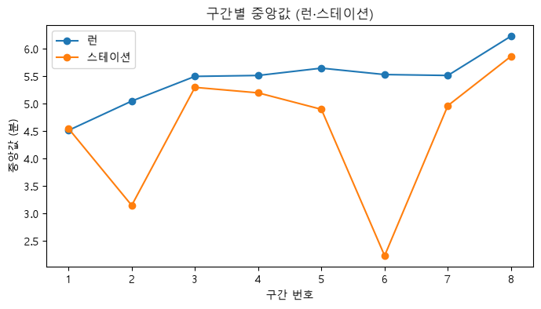
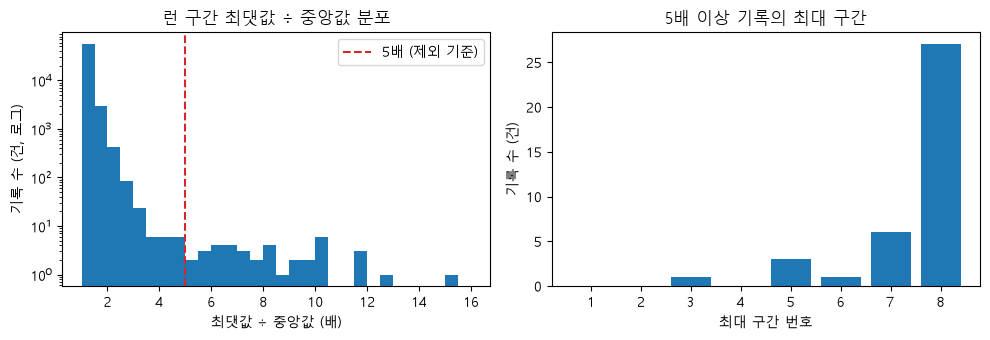
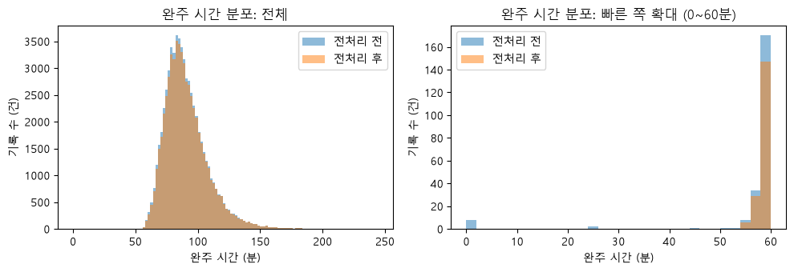
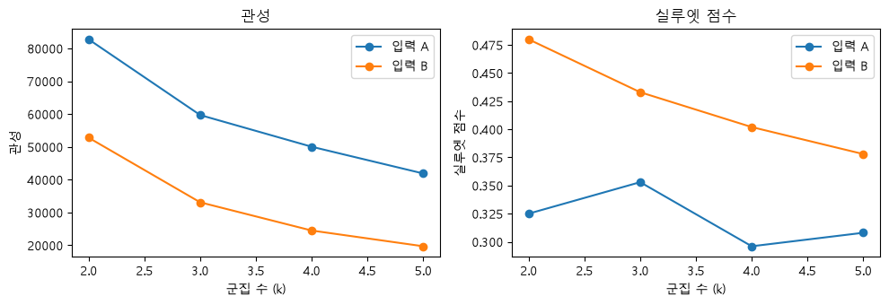
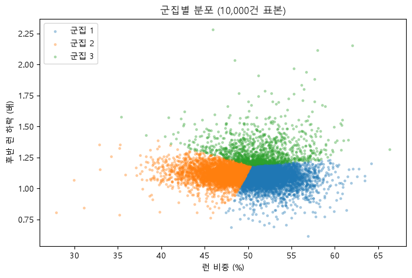
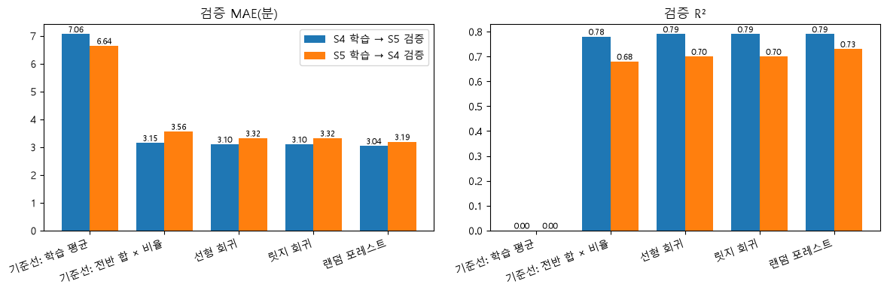
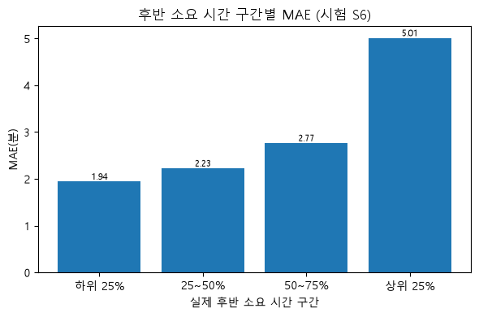
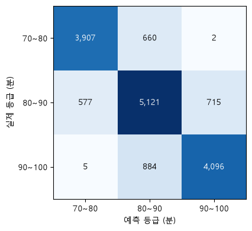

# HYROX 대회 기록 분석

정형 데이터로 EDA부터 군집·회귀·분류까지 해 본 ML 분석 프로젝트

HYROX 대회 기록 92,374건(Kaggle)에서 open·pro 부문 61,832건을 대상으로, 전처리 기준을 세우고 구간별 기록으로 군집·회귀·분류를 수행한 분석입니다. 사용 도구는 pandas, scikit-learn, matplotlib입니다.

## 프로젝트 개요

- 목적: 정형 데이터 ML 분석의 전 과정(EDA → 전처리 → 군집 → 회귀 → 분류) 수행, 단계마다 기준과 근거를 노트북에 기록
- 데이터: Kaggle [Hyrox Race Results](https://www.kaggle.com/) (jgug05), 92,374행 × 34열, 2021~2023, CC BY 4.0
- 분석 범위: open·pro 부문 61,832건 (doubles·relay 등 형식이 다른 경기는 제외)
- 분석 데이터: 전처리 후 59,886건 (open 49,041건, pro 10,845건)
- 행의 의미: 1회 완주 기록. 선수 식별 열이 없어 같은 선수의 기록 여부는 구분 불가
- 구간 구성: 런·스테이션·록스존 각 8구간, 총 24개 구간 열과 합계 열

## 주요 결과

| 노트북 | 단계 | 내용 | 결과 |
|---|---|---|---|
| [01](notebooks/01_eda.ipynb) | EDA | 완주 시간 분포, 구간별 중앙값 | 완주 시간 중앙값 87.7분 (open 89.0분, pro 82.7분), 구간 중앙값 합계는 런 43.5분 > 스테이션 36.2분 > 록스존 6.4분 |
| [02](notebooks/02_preprocessing.ipynb) | 전처리 | 중복·구간 0초·구간 이상 기록 제외 | 61,832 → 59,886건 (-1,946건, 3.1%) |
| [03](notebooks/03_clustering.ipynb) | 군집 | 런 비중·후반 런 하락으로 K-Means (k=3) | 실루엣 0.353, 군집별 총 기록 중앙값 84.0 / 90.0 / 103.2분 |
| [04](notebooks/04_regression.ipynb) | 회귀 | 전반 12열로 후반 소요 시간 예측 | 시험(S6) MAE 2.99분, R² 0.80 (랜덤 포레스트) |
| [05](notebooks/05_classification.ipynb) | 분류 | 전반 12열로 총 기록 3등급 분류 | 시험(S6) 정확도 0.822, 매크로 F1 0.827 (로지스틱 회귀) |

### 01 EDA: 완주 시간과 구간별 기록



- pro가 빠른 쪽에 위치하고 open은 오른쪽 꼬리가 더 길며, 두 분포는 넓게 중첩



- 런 중앙값은 1구간 4:31이 최단, 8구간 6:14가 최장이며, 런이 스테이션보다 큰 구간은 8개 중 7개

### 02 전처리: 제외 기준과 영향



- 런 구간 하나가 자기 중앙값의 5배 이상인 38건을 제외, 최대 구간은 8구간이 27건으로 가장 많음. 5배는 분포에 뚜렷한 경계가 없어 판단으로 정한 값



- 전처리 후 완주 시간 중앙값 87.7 → 87.9분, 최솟값 0.0 → 54.1분

### 03 군집: 시간 배분 기준 3개 군집

| 군집 | 기록 수 (건) | 런 비중 | 후반 런 하락 | 총 기록 중앙값 (분) |
|---|---|---|---|---|
| 1 | 29,369 | 0.521 | 1.092 | 84.0 |
| 2 | 23,448 | 0.474 | 1.120 | 90.0 |
| 3 | 7,069 | 0.511 | 1.271 | 103.2 |





- 세 군집은 서로 이어진 한 덩어리 분포로 나뉘며 떨어진 군집은 없음
- 후반 런 하락 = 런 5~8구간 평균 ÷ 런 1~4구간 평균 (1보다 클수록 후반 런이 느림)
- 총 기록은 군집 입력에 쓰지 않고 군집 번호 정렬과 비교에만 사용

### 04 회귀: 후반(5~8구간) 소요 시간 예측

| 시험(S6) | MAE (분) | R² |
|---|---|---|
| 기준선: 학습 평균 | 7.16 | -0.01 |
| 기준선: 전반 합 × 비율 | 3.36 | 0.77 |
| 랜덤 포레스트 (선택) | 2.99 | 0.80 |



- 랜덤 포레스트가 검증 두 방향 모두 MAE가 가장 작지만, 선형 모델과의 차이는 0.06~0.13분



- 오차(예측 − 실제) 평균 -0.13분, 오차 절대값 중앙값 2.14분
- 후반 소요 시간이 긴 상위 25% 구간의 MAE는 5.01분으로 가장 큼 (하위 25% 구간은 1.94분)

### 05 분류: 총 기록 등급 (70~80분 / 80~90분 / 90~100분)

| 시험(S6) | 정확도 | 매크로 F1 |
|---|---|---|
| 기준선: 최빈 등급 | 0.402 | 0.191 |
| 기준선: 전반 합 환산 | 0.732 | 0.759 |
| 로지스틱 회귀 (선택) | 0.822 | 0.827 |



- 틀린 2,843건 중 2,836건이 한 등급 차이, 두 등급 차이는 7건

## 분석에서 지킨 기준

- **시즌 단위 분할**: 원본이 대회 단위로 묶여 있어 `head`로 자르지 않고, 대회 이름의 시즌(S4·S5·S6)으로 분할. 학습 S4·S5, 시험 S6
- **시험 데이터 분리**: 모델은 학습 데이터 안의 시즌 2분할 검증(S4→S5, S5→S4)으로 고르고, S6은 선택한 모델과 기준선에 한 번만 사용
- **누수 방지**: 총 기록 = 런 + 스테이션 + 록스존이 전 기록에서 성립(불일치 0건). 입력은 전반 1~4구간, 예측 대상은 후반 5~8구간으로 나누어 겹침 없음 확인
- **기준선 비교**: 모델 점수를 단순 기준선(평균, 전반 합 환산)과 함께 제시
- **설정값**: scikit-learn 공식 문서 기본값 사용. 근거 없이 정한 값(`random_state=42`, 등급 경계, 구간 수 등)은 노트북에 근거 없음으로 표기
- **관찰과 추정 구분**: 각 절의 결과에는 확인한 값만, 해석과 한계는 별도 항목에 기록

## 한계

- 회귀(04): 랜덤 포레스트와 선형 모델의 MAE 차이는 0.06~0.13분(검증)으로 작고 검증이 2회뿐이라 의미 있는 차이인지 구분 불가. 전반 합 × 비율 기준선 대비 개선은 0.37분
- 분류(05): 라벨이 총 기록에서 만들어지고 입력인 전반 기록이 그 일부라 점수가 높게 나올 수 있음. 정확도·F1은 등급 순서를 반영하지 않으며, 점수는 총 기록 70~100분 범위 안 기록에 한정
- 분류(05): open·pro의 스테이션 무게 차이가 데이터에 없어 부문 간 같은 시간의 의미가 다를 수 있음
- 군집(03): 실루엣 0.353으로 경계가 뚜렷하지 않아 유형이 아닌 경향 수준의 구분. 후반 런 하락의 극단 기록이 군집 중심에 준 영향은 검증하지 않음
- 전처리(02): 구간 이상 38건을 제외한 결과와 유지한 결과의 비교는 하지 않음
- 선수 식별 열이 없어 같은 선수의 기록이 학습과 시험 양쪽에 있는지, 제외한 기록의 원인이 무엇인지는 구분 불가
- 2021~2023 데이터라 최신 경향은 반영하지 못함

## 노트북 구성

| 노트북 | 내용 |
|---|---|
| [`01_eda.ipynb`](notebooks/01_eda.ipynb) | 시간 문자열(`hh:mm:ss`)의 초 단위 변환, 완주 시간 분포, 구간별 중앙값 |
| [`02_preprocessing.ipynb`](notebooks/02_preprocessing.ipynb) | 중복·구간 0초·구간 이상 기록의 제외 기준과 영향 건수, 분석용 데이터 `hyrox_clean.csv` 생성 |
| [`03_clustering.ipynb`](notebooks/03_clustering.ipynb) | 시간 배분 특징 4개 확인, K-Means 군집 수 선택(k=2~5), 군집별 프로파일 |
| [`04_regression.ipynb`](notebooks/04_regression.ipynb) | 전반 12열 → 후반 소요 시간. 선형 회귀·릿지 회귀·랜덤 포레스트 비교, 오차 확인 |
| [`05_classification.ipynb`](notebooks/05_classification.ipynb) | 전반 12열 → 총 기록 3등급. 로지스틱 회귀·랜덤 포레스트 비교, 혼동행렬 |

용어 정리는 [`docs/glossary.md`](docs/glossary.md)에 있습니다.

## 실행 방법

### 1. 환경

| 항목 | 버전 |
|---|---|
| Python | 3.12 |
| pandas | 3.0.6 |
| scikit-learn | 1.9.1 |
| matplotlib | 3.11.2 |
| openpyxl | 3.1.5 |

```bash
conda create -n hyrox-analysis python=3.12
conda activate hyrox-analysis
pip install pandas==3.0.6 scikit-learn==1.9.1 matplotlib openpyxl jupyter ipykernel
```

### 2. 데이터 준비

- Kaggle Hyrox Race Results에서 엑셀 파일을 내려받아 `data/hyrox_results.xlsx`로 저장
- `data/` 폴더는 Git에서 제외되어 있어 직접 만들어야 함

### 3. 실행 순서

노트북은 앞 단계의 저장 파일을 읽으므로 01부터 순서대로 실행.

| 순서 | 노트북 | 읽는 파일 | 저장하는 파일 |
|---|---|---|---|
| 1 | 01 | `data/hyrox_results.xlsx` | `data/hyrox_results.csv` |
| 2 | 02 | `data/hyrox_results.csv` | `data/hyrox_clean.csv` |
| 3~5 | 03, 04, 05 | `data/hyrox_clean.csv` | 없음 |

- 노트북은 `notebooks/` 폴더 기준 상대 경로(`../data/`)를 사용
- 그래프 한글 폰트는 `Malgun Gothic`(Windows 기준)으로 지정. macOS·Linux에서는 각 노트북 첫 코드 셀의 `plt.rc("font", family=...)`를 설치된 한글 폰트로 변경

## 폴더 구조

```
hyrox-analysis/
├── notebooks/
│   ├── 01_eda.ipynb
│   ├── 02_preprocessing.ipynb
│   ├── 03_clustering.ipynb
│   ├── 04_regression.ipynb
│   └── 05_classification.ipynb
├── docs/
│   └── glossary.md
├── images/                # README용 그래프 (노트북 출력에서 추출)
├── data/                  # Git 제외, 직접 준비
│   ├── hyrox_results.xlsx
│   ├── hyrox_results.csv  # 01에서 생성
│   └── hyrox_clean.csv    # 02에서 생성
└── README.md
```

## 데이터 출처

- Kaggle, Hyrox Race Results (jgug05), CC BY 4.0
- 스테이션 순서(1 스키에르그, 2 슬레드 푸시, 3 슬레드 풀, 4 버피 브로드 점프, 5 로잉, 6 파머스 캐리, 7 샌드백 런지, 8 월볼)는 HYROX 공개 규격을 적용한 것으로, 데이터에는 종목 이름 열이 없음
