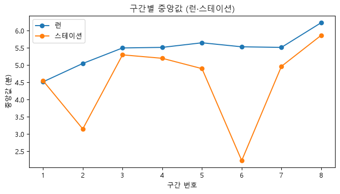
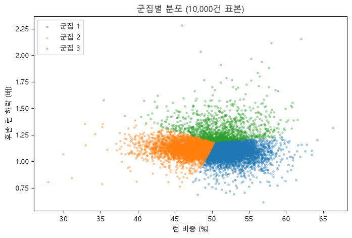
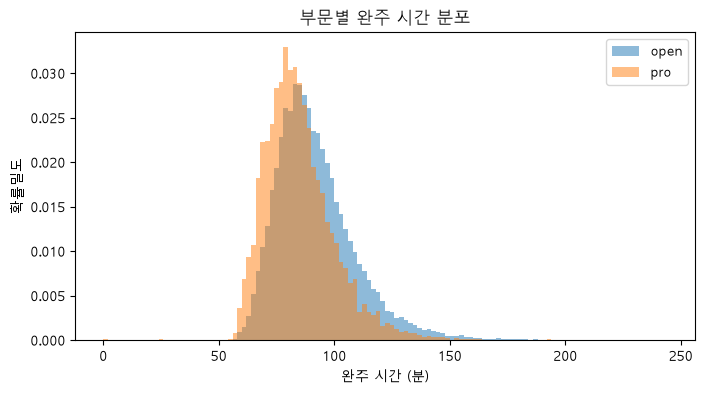
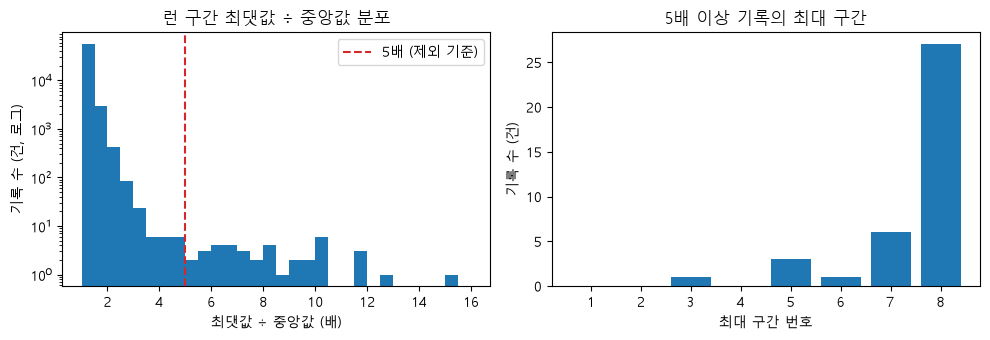
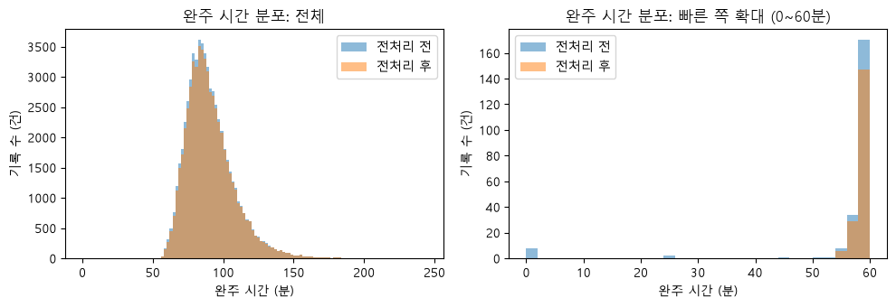
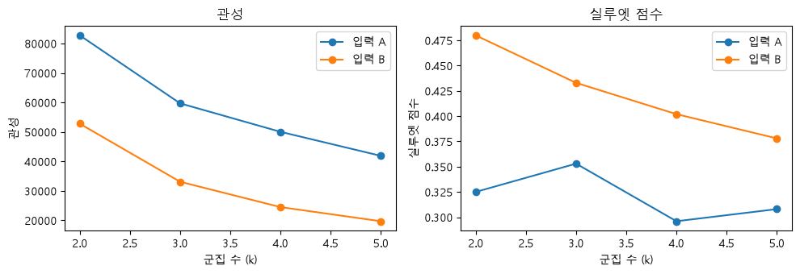
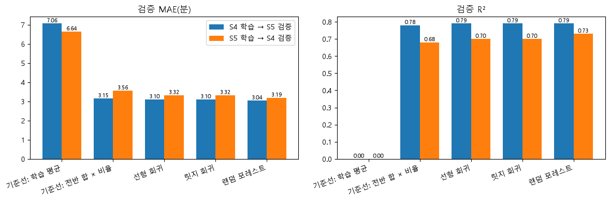
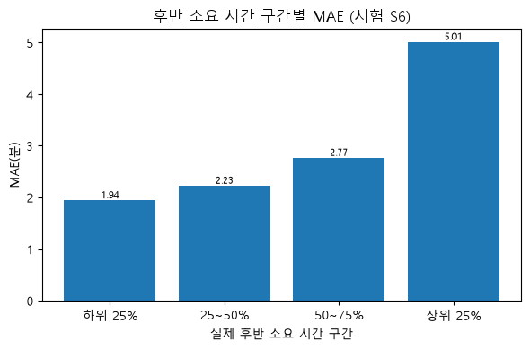
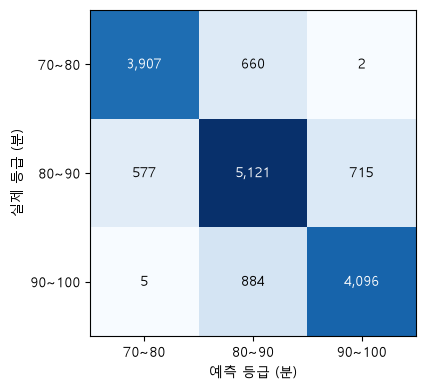

# HYROX 대회 기록 분석

> **질문** 사람들은 HYROX 후반에 실제로 얼마나 느려질까?
>
> **답** 참가자 약 95%가 후반 런에서 같거나 느려졌고, 절반은 11% 이상 느려짐
>
> 대회 기록 약 6만 건으로 EDA → 전처리 → 군집 → 회귀 → 분류까지 수행한 정형 데이터 ML 분석 프로젝트

## 기술 스택 및 역량


| 기술 | 활용 |
|---|---|
| pandas | 시간 문자열 변환, 집계, 전처리 기준 적용 |
| scikit-learn | K-Means·실루엣 점수(군집), 선형·릿지 회귀·랜덤 포레스트(회귀), 로지스틱 회귀·랜덤 포레스트(분류) |
| matplotlib | 분포·구간별 비교·군집·오차·혼동행렬 시각화 |

| 역량 | 내용 |
|---|---|
| 평가 설계 | 시즌 단위 학습·시험 분할, 시즌 교차 검증으로 모델 선택, 시험 데이터 1회 사용 |
| 데이터 누수 점검 | 입력(1~4구간)·예측 대상(5~8구간) 분리, 구간 합계 일치 확인 |
| 기준선 비교 | 모든 모델을 단순 계산 결과와 비교하고 개선 폭 그대로 기록 |
| 결과 안정성 확인 | 표본 크기·초기화 횟수를 바꿔 군집 결과 재확인 |
| 분석 기록 | 제외 기준별 영향 건수, 근거 없이 정한 값, 단계별 한계 명시 |
| 도메인 기반 문제 정의 | 대회 참가 경험에서 나온 질문을 데이터로 검증 |

- 역량별 구체적인 기준은 [분석 기준 상세](#분석-기준-상세) 참고

## 프로젝트 구성

```
01 EDA ──▶ 02 전처리 ──▶ 03 군집
                    ├──▶ 04 회귀
                    └──▶ 05 분류
```

| 단계 | 내용 |
|---|---|
| [01 EDA](notebooks/01_eda.ipynb) | 완주 시간 분포와 구간별 기록으로 데이터 구조 파악 |
| [02 전처리](notebooks/02_preprocessing.ipynb) | 중복·0초 구간·이상 기록의 제외 기준 수립 |
| [03 군집](notebooks/03_clustering.ipynb) | 후반 감속 정도와 시간 배분으로 선수 경향 구분 |
| [04 회귀](notebooks/04_regression.ipynb) | 전반 기록으로 후반 소요 시간 예측 |
| [05 분류](notebooks/05_classification.ipynb) | 전반 기록으로 완주 시간 등급 예측 |

- **전반 = 1~4구간, 후반 = 5~8구간** (1구간 = 1km 런 + 운동 스테이션 1개 + 전환 구간, 자세한 내용은 [HYROX 경기 구성](#hyrox-경기-구성) 참고)

## 주요 발견

### 1. 대부분의 참가자가 후반 런에서 느려짐

| 후반 감속 비율 | 하위 5% | 하위 25% | 중앙값 | 상위 5% |
|---|---|---|---|---|
| 값 | 0.995 | 1.070 | 1.114 | 1.291 |
| 의미 | 약 95%가 같거나 느림 | 75%가 7% 이상 느림 | 절반이 11% 이상 느림 | 5%가 29% 이상 느림 |



- 후반 감속 비율 = 5~8구간 런 평균 ÷ 1~4구간 런 평균 (1보다 크면 후반이 느림)
- 런 중앙값: 1구간 4:31이 최단, 8구간 6:14가 최장

### 2. 차이는 느려지는지가 아니라 얼마나 느려지는지에서 발생

| 군집 | 기록 수 (건) | 후반 감속 비율 (중앙값) | 완주 시간 중앙값 (분) |
|---|---|---|---|
| 1 | 29,369 | 1.092 | 84.0 |
| 2 | 23,448 | 1.120 | 90.0 |
| 3 | 7,069 | 1.271 | 103.2 |



- 런 시간 비중·후반 감속 비율로 K-Means (k=3), 실루엣 0.353
- 감속이 가장 큰 군집 3의 완주 시간이 가장 김

### 3. 전반 기록으로 후반 소요 시간 예측 가능, 단 단순 계산 대비 개선 폭은 작음

| 시험 데이터(S6) | MAE (분) | R² |
|---|---|---|
| 기준선: 1~4구간 합 × 비율 | 3.36 | 0.77 |
| **랜덤 포레스트 (선택)** | **2.99** | **0.80** |

### 4. 완주 시간 등급 분류 오답은 대부분 인접 등급

| 시험 데이터(S6) | 정확도 | 매크로 F1 |
|---|---|---|
| 기준선: 1~4구간 합으로 완주 시간 환산 | 0.732 | 0.759 |
| **로지스틱 회귀 (선택)** | **0.822** | **0.827** |

- 오답 2,843건 중 2,836건이 한 등급 차이, 두 등급 차이는 7건

## 프로젝트 동기

- HYROX 대회 참가 경험에서 출발
- 참가 당시 "후반에 느려지는 사람이 많아 체력 배분이 중요하다"는 이야기를 자주 접함
- 구간별 기록이 모두 남아 있는 공개 데이터를 발견
- **핵심 질문: 후반에 느려지는 선수가 정말 많은가, 많다면 얼마나 느려지는가**

## HYROX 경기 구성

- 1km 달리기(런)와 운동 스테이션을 번갈아 8회 반복하는 피트니스 대회
  - 런 1km → 운동 스테이션 1 → 런 1km → 운동 스테이션 2 → … → 운동 스테이션 8 → 결승
- 운동 스테이션 순서
  - 스키에르그 → 슬레드 푸시 → 슬레드 풀 → 버피 브로드 점프 → 로잉 → 파머스 캐리 → 샌드백 런지 → 월볼
- 록스존(Roxzone): 런과 운동 스테이션 사이를 이동하는 전환 구간
- 이 분석에서 **1구간 = 런 1회 + 운동 스테이션 1개 + 록스존 1회**
  - 8구간 × 3종류 = 기록 열 24개
  - 8구간 록스존은 마지막 스테이션 뒤가 바로 결승선이라 모든 기록이 0초 → 실제 분석 대상은 23개
- 부문
  - 오픈 싱글: 일반 개인 부문
  - 프로 싱글: 운동 스테이션 무게가 더 무거운 개인 부문

## 데이터

- 출처: Kaggle [Hyrox Race Results](https://www.kaggle.com/datasets/jgug05/hyrox-results) (jgug05), CC BY 4.0
- 원본: 92,374행 × 34열, 시즌 4~6 (S4~S6)
- 분석 범위: 오픈 싱글·프로 싱글 부문 61,832건
  - 2인(더블)·4인 릴레이 등 경기 형식이 다른 부문 제외
- 분석 데이터: 전처리 후 59,886건 (오픈 싱글 49,041건, 프로 싱글 10,845건)
- 행의 의미: 1회 완주 기록
  - 선수 식별 열이 없어 같은 선수의 기록인지 구분 불가

## 분석 기준 상세

- **평가 설계**
  - 원본이 대회 단위로 묶여 있어 앞에서부터 자르지 않고 시즌으로 분할 (학습: 시즌 4·5, 시험: 시즌 6)
  - 모델 선택은 학습 데이터 안의 시즌 교차 검증(S4→S5, S5→S4)으로 수행
  - 시즌 6은 선택한 모델과 기준선 평가에 한 번만 사용
- **데이터 누수 점검**
  - 입력은 1~4구간, 예측 대상은 5~8구간으로 나누어 겹침 없음 확인
  - 완주 시간 = 런 + 운동 스테이션 + 록스존 합이 모든 기록에서 일치 (불일치 0건)
- **기준선 비교**
  - 모든 모델 점수를 단순 계산 결과(기준선)와 함께 제시
- **결과 안정성 확인**
  - 실루엣 계산 표본 크기(5천·1만·2만 건), K-Means 초기화 횟수(`n_init` 1·10·30)를 바꿔 군집 결과 재확인
- **분석 기록**
  - 전처리 제외 기준마다 영향 건수 기록
  - scikit-learn 기본값 사용, 근거 없이 정한 값(`random_state=42`, 등급 경계, 이상 기록 5배 기준 등)은 노트북에 명시
  - 결과에는 확인한 값만, 해석과 한계는 별도 기록

## 단계별 상세 결과

<details>
<summary><b>01 EDA: 완주 시간과 구간별 기록</b></summary>



- 완주 시간 중앙값 87.7분 (오픈 싱글 89.0분, 프로 싱글 82.7분)
- 프로 싱글이 빠른 쪽에 위치, 오픈 싱글은 느린 쪽 꼬리가 더 김
- 두 분포는 넓게 겹침
- 구간 중앙값 합계: 런 43.5분 > 운동 스테이션 36.2분 > 록스존 6.4분
- 런이 운동 스테이션보다 오래 걸린 구간: 8개 중 7개

</details>

<details>
<summary><b>02 전처리: 제외 기준과 영향</b></summary>



- 61,832 → 59,886건 (-1,946건, 3.1%)
- 런 구간 하나가 해당 구간 중앙값의 5배 이상인 38건 제외
  - 가장 긴 구간이 8구간인 경우가 27건으로 가장 많음
  - 5배 기준은 분포에 뚜렷한 경계가 없어 판단으로 정한 값



- 완주 시간 중앙값 87.7 → 87.9분
- 완주 시간 최솟값 0.0 → 54.1분

</details>

<details>
<summary><b>03 군집: 군집 수 선택과 프로파일</b></summary>



- k=2~5 중 실루엣 최대 k=3 (0.353), 관성 감소 폭도 k=2→3이 가장 큼

| 군집 | 기록 수 (건) | 런 시간 비중 | 후반 감속 비율 | 완주 시간 중앙값 (분) |
|---|---|---|---|---|
| 1 | 29,369 | 0.521 | 1.092 | 84.0 |
| 2 | 23,448 | 0.474 | 1.120 | 90.0 |
| 3 | 7,069 | 0.511 | 1.271 | 103.2 |

- 런 시간 비중 = 런 시간 합 ÷ 완주 시간
- 후반 감속 비율은 노트북의 "후반 런 하락"과 같은 값
- 세 군집은 이어진 한 덩어리 분포를 나눈 것으로, 뚜렷이 떨어진 군집은 없음
- 완주 시간은 군집 입력에 쓰지 않고 군집 정렬과 비교에만 사용

</details>

<details>
<summary><b>04 회귀: 모델 비교와 오차 분석</b></summary>

- 입력: 1~4구간의 런·운동 스테이션·록스존 기록 12개
- 예측 대상: 5~8구간 소요 시간 합 (8구간 록스존 제외 11개 구간)

| 시험 데이터(S6) | MAE (분) | R² |
|---|---|---|
| 기준선: 학습 데이터 평균 | 7.16 | -0.01 |
| 기준선: 1~4구간 합 × 비율 | 3.36 | 0.77 |
| **랜덤 포레스트 (선택)** | **2.99** | **0.80** |



- 랜덤 포레스트가 검증 두 방향 모두 MAE 최소
- 단, 선형 모델과의 차이는 0.06~0.13분



- 오차(예측 − 실제) 평균 -0.13분, 오차 절대값 중앙값 2.14분
- 5~8구간 소요 시간이 긴 상위 25%의 MAE 5.01분으로 가장 큼 (하위 25%는 1.94분)

</details>

<details>
<summary><b>05 분류: 완주 시간 등급 (70~80 / 80~90 / 90~100분)</b></summary>

- 입력: 1~4구간 기록 12개
- 예측 대상: 완주 시간 3등급

| 시험 데이터(S6) | 정확도 | 매크로 F1 |
|---|---|---|
| 기준선: 가장 많은 등급으로 일괄 예측 | 0.402 | 0.191 |
| 기준선: 1~4구간 합으로 완주 시간 환산 | 0.732 | 0.759 |
| **로지스틱 회귀 (선택)** | **0.822** | **0.827** |



- 오답 2,843건 중 2,836건이 한 등급 차이
- 두 등급 차이는 7건

</details>

## 한계

- 후반 감속의 원인(피로, 페이스 배분, 직전 운동 스테이션 영향 등)은 이 데이터로 확인 불가
- 회귀: 랜덤 포레스트와 선형 모델의 차이(0.06~0.13분)가 작고 검증이 2회뿐이라 의미 있는 차이인지 구분 불가
- 분류: 등급(완주 시간)에 입력(1~4구간 기록)이 포함되어 점수가 높게 나올 수 있음
- 분류: 오픈·프로 싱글의 운동 스테이션 무게 차이가 데이터에 없어, 같은 시간이라도 부문 간 의미가 다를 수 있음
- 군집: 실루엣 0.353으로 경계가 뚜렷하지 않아 유형이 아닌 경향 수준의 구분
- 전처리: 이상 기록 38건을 제외한 결과와 유지한 결과는 비교하지 않음
- 모델 설정: scikit-learn 기본값만 사용
- 선수 식별 열이 없어 학습·시험 데이터에 같은 선수가 있는지 확인 불가
- 시즌 4~6 데이터라 최신 경향은 반영하지 못함

## 회고

- **정형 데이터 ML 분석 전 과정을 처음부터 끝까지 직접 수행**
  - EDA → 전처리 → 군집 → 회귀 → 분류를 하나의 데이터셋으로 진행
- **과정에서 체감한 점**
  - 데이터를 어떻게 나누느냐(시즌 단위 분할)에 따라 평가 결과가 달라짐
  - 모델 점수는 단순 기준선과 비교해야 의미가 생김

## 실행 방법

### 1. 환경

```bash
conda create -n hyrox-analysis python=3.12
conda activate hyrox-analysis
pip install pandas==3.0.6 scikit-learn==1.9.1 matplotlib==3.11.2 openpyxl==3.1.5 jupyter ipykernel
```

### 2. 데이터 준비

- [Kaggle Hyrox Race Results](https://www.kaggle.com/datasets/jgug05/hyrox-results)에서 데이터를 내려받아 `data/hyrox_results.xlsx`로 저장
- `data/` 폴더는 Git에서 제외되어 있어 직접 생성 필요

### 3. 실행 순서

- 노트북은 앞 단계의 저장 파일을 읽으므로 01부터 순서대로 실행

| 순서 | 노트북 | 읽는 파일 | 저장하는 파일 |
|---|---|---|---|
| 1 | 01 | `data/hyrox_results.xlsx` | `data/hyrox_results.csv` |
| 2 | 02 | `data/hyrox_results.csv` | `data/hyrox_clean.csv` |
| 3~5 | 03, 04, 05 | `data/hyrox_clean.csv` | 없음 |

- 경로는 `notebooks/` 폴더 기준 상대 경로(`../data/`)
- 그래프 한글 폰트는 `Malgun Gothic`(Windows 기준)
  - macOS·Linux에서는 각 노트북 첫 코드 셀의 `plt.rc("font", family=...)`를 설치된 한글 폰트로 변경

## 폴더 구조

```
hyrox-analysis/
├── notebooks/          # 01~05 분석 노트북
├── docs/
│   └── glossary.md     # 용어 정리
├── images/             # README용 그래프
├── data/               # Git 제외, 직접 준비
└── README.md
```

## 데이터 출처

- Kaggle, [Hyrox Race Results](https://www.kaggle.com/datasets/jgug05/hyrox-results) (jgug05), CC BY 4.0
- 데이터의 운동 스테이션 기록은 `work_1`~`work_8` 번호로만 구분되어 있어, 종목 이름은 HYROX 공개 규격의 순서를 적용